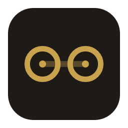
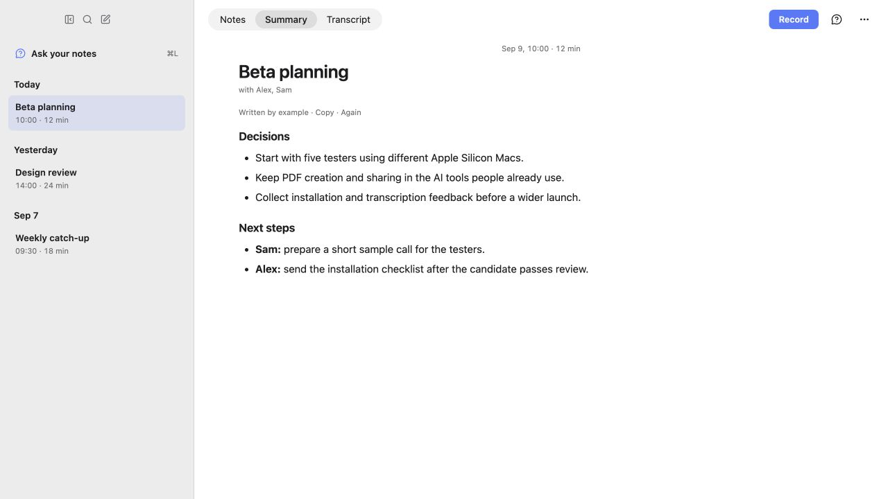

# simstim



**Your calls. Your files. Your AI.**

simstim records and transcribes calls on your Mac, then saves each one as a
plain Markdown file with its audio in a folder you choose. Open it in
Obsidian, search it, back it up, or give it to the AI tools you already use.

No simstim account, subscription, telemetry or AI credits. Open source, MIT.
macOS 14.2+ on Apple Silicon. First public beta preparation is in progress.

[Download releases](https://github.com/pgrekovich/simstim/releases) ·
[Example note](docs/examples/2026-09-09%2010-00-00%20call.md) ·
[Privacy](docs/privacy.md) · [Getting help](CONTRIBUTING.md#reporting-a-bug)



*The real interface, shown with fictional example data.*

## Keep the recorder simple

You already have an AI assistant. Your meetings should work with it.

Want a PDF, a presentation, a follow-up email or a document to share? Give
the note to your usual Claude or ChatGPT workflow. Use its document tools
and the integrations you have already set up. There is no reason for your
recorder to sell you another export button or another AI plan.

simstim handles the part that needs a dedicated app: capturing both sides
of a call, preserving the recording, and turning it into useful text.
Everything after that can happen in your own tools.

For convenience, simstim can also summarize and answer questions through
**Claude Code or Codex**, using your own account. Connect an assistant
in Settings; simstim can install the official helper for you. Eligible Claude and ChatGPT subscriptions can provide that access;
your provider's limits and billing settings still apply. simstim adds no fee.

Prefer another setup, including a local model? Turn off automatic summaries
and use the Markdown files with your own assistant. Recording, transcription,
notes, playback and ordinary search work without an AI account.

## From a call to a file

1. **Start deliberately.** Click Record, or accept the banner when simstim
   detects a call. Detection never starts recording by itself.
2. **Follow the conversation.** Local speech recognition shows a live
   transcript. Your microphone is **Me**; system audio is **Them**.
3. **Keep your own notes.** What you type stays separate from generated text.
4. **Get the accurate pass.** After Stop, Whisper re-reads the saved audio
   in the background. Optional AI summaries use your configured assistant.
5. **Use the result anywhere.** The `.md` in your folder is the actual note.
   The audio stays beside it. No export step.

Click a transcript timestamp to hear that moment. Search past calls or ask
across your notes, with source links back to the conversation. Continue a
recording in an existing note without restarting its timeline. Wait for that
note's transcription or summary to finish before continuing it.

## Install

Download a DMG from [Releases](https://github.com/pgrekovich/simstim/releases),
open it and drag Simstim into Applications. Release builds are signed with
a Developer ID and notarized by Apple.

On first launch, choose a notes folder, grant microphone and system-audio
access, and choose whether to use automatic summaries. Speech models
download automatically: approximately **1.55 GB** for the default pair.
The first recording can start once the live model is ready; the accurate
pass becomes available when its model finishes downloading.

Models are stored in `~/Library/Application Support/simstim/models/`.
Notes default to `~/Documents/simstim`; an Obsidian vault works too.

For built-in AI, choose **Connect Claude** or **Connect ChatGPT** and finish
the official browser sign-in. simstim sets up the needed helper without a
terminal. No simstim account is needed; you can skip AI entirely.
[AI setup and example workflows](docs/your-ai.md).

## What stays local

| Operation | Where it happens |
|---|---|
| Recording and speech recognition | On your Mac; simstim never uploads audio |
| Notes, transcripts, retained audio and ordinary search | Your files on your Mac |
| Automatic summaries, if enabled | Note text goes through your configured AI CLI to its provider |
| Ask this call / Ask your notes | Your question and the note text read by the CLI go to its provider |
| Optional calendar and connector lookups | Through supported read operations in your Claude Code connectors |
| PDF, sharing and other work in your own assistant | Under that assistant's permissions and data policies |

simstim has no hosted data store and sends no telemetry. Model downloads
need the internet. Optional AI and connector features also use the network
through your configured tools. A folder you sync or share follows your own
sync settings. [Full privacy and storage details](docs/privacy.md).

## The file

One call is one `.md` file and, by default, one `.m4a` audio file with the
same basename. FLAC is available through the configuration file.

```markdown
---
date: 2026-09-09T10:00:00+02:00
title: Beta planning
asr: whisper-large-v3-turbo-q8
duration: 12m
---

## Notes

Keep the first release focused on recording and readable files.

## Transcript

[00:00:04] Me: Let's start with five testers on different Macs.
[00:00:09] Them: I'll prepare a short sample call for them.
```

When generated, `## Summary` is a separate section with model provenance in
frontmatter. Your notes remain yours. See the [complete fictional example](docs/examples/2026-09-09%2010-00-00%20call.md).

## Beta limits

- **Apple Silicon only.** Windows, Linux and Intel Macs are not supported.
- **Me/Them are channels, not named speakers.** Several remote participants
  share Them. Headphones help prevent their voices leaking into your mic.
- **Recognition makes mistakes.** Names, numbers and mixed-language speech
  deserve a check against the audio. Re-transcription timestamps can drift.
- **Built-in summaries and questions need Claude Code or Codex.** There is
  no bundled local summarizer; use your own local tools on the files if desired.
- **Edit finished files externally.** Avoid simultaneous edits from another
  app while simstim records or processes that note. Improving the transcript
  replaces its section; external transcript edits may be replaced too.
- **Update manually.** Download a newer DMG and replace the app. Notes and
  models live separately. Beta feedback is welcome.

Tell the people on your call before recording, and follow the requirements
that apply to your conversation.

## Configuration

Settings and `~/.config/simstim/config.toml` edit the same configuration.
Your summary instructions, styles and quick questions live beside it in
`prompts.toml`. [Full configuration reference](docs/configuration.md).

## Development and contributions

[Build and test](docs/development.md) · [Contributing](CONTRIBUTING.md) ·
[Roadmap](docs/ROADMAP.md) · [Beta release checklist](docs/beta-release.md)

Small, well-tested improvements to reliability and the everyday workflow
are welcome. New export formats and service integrations usually belong in
the tools that consume these files. Explain the problem before adding a
new surface to the recorder.

## Acknowledgements and license

Built with Tauri, Rust, React, sherpa-onnx, Silero VAD and whisper.cpp.
Thanks to the local-audio and transcription projects that made this possible.
[Third-party acknowledgements](THIRD_PARTY_NOTICES.md).

[MIT license](LICENSE). Models and dependencies retain their own licenses.

*simstim*, from William Gibson's *Neuromancer*: replaying someone's recorded
sensory experience. This app replays your calls as text.
