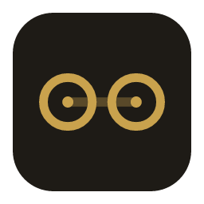
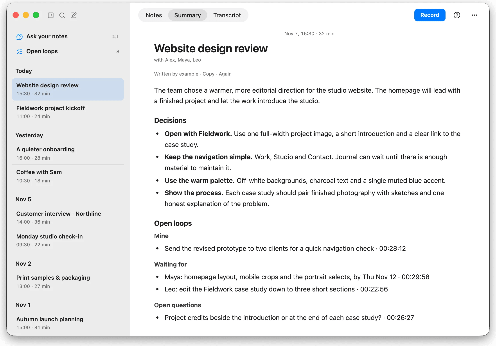
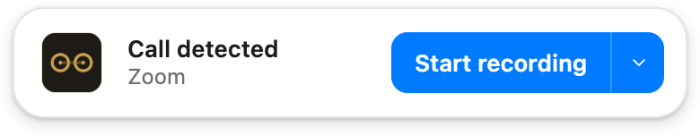
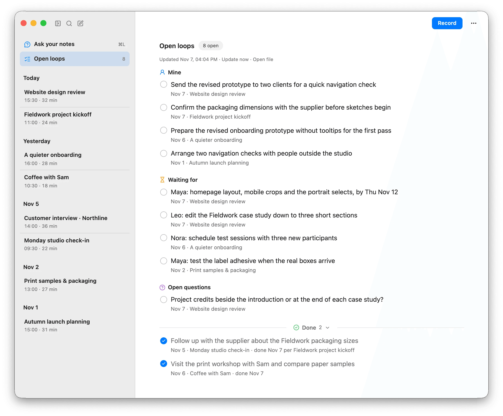

<p align="center">
  
</p>

<h1 align="center">simstim</h1>

<p align="center">
  <strong>Your calls. Your files. Your AI.</strong><br>
  Record and transcribe calls on your Mac. Keep them as Markdown,<br>
  and every promise from your calls in one list.
</p>

<p align="center">
  <a href="https://simstim.tech/download"><strong>Download for macOS</strong></a> ·
  <a href="#getting-started">Get started</a> ·
  <a href="docs/privacy.md">Privacy</a> ·
  <a href="docs/development.md">Build from source</a>
</p>

<p align="center"><sub>macOS 14.2+ · Apple Silicon · Free · MIT license</sub></p>



## Recording

Simstim records your microphone and system audio, transcribes the call
locally, and saves it in a folder you choose. Audio stays on your Mac.

- A live transcript appears during the call. After you stop, a second local
  transcription pass improves accuracy.
- You can take notes during the call. Your notes, the transcript and AI
  summaries have separate sections.
- Search across past calls. If you keep the audio, click a timestamp to
  play that part of the recording.
- Resume recording into an existing note. Earlier audio and timestamps
  are preserved.
- When Zoom, Teams, FaceTime, Slack or a browser tab starts using the
  microphone, a small banner offers to record. Recording starts only when
  you click. While it runs, the toolbar shows whether you and the other side
  are being heard, and the menu bar shows the time with Stop and Add note.



## Open loops

A call ends with things you agreed to do, things others agreed to do for
you and questions nobody answered. Every summary ends with them, each with
the moment in the call where it was said.



`Open loops.md` sits beside your calls and gathers them in four sections:
Mine, Waiting for, Open questions and Done. After each summary, Simstim adds
the call's new loops and checks off the ones the call reports as done. Each
item links to its call and the second it was agreed. Check items off in the
app or in any editor; Done keeps four weeks of history and then clears.

Simstim only adds lines and checks lines in that file. It never rewords or
deletes yours. There are no priorities, reminders or badges: it is one
Markdown file with checkboxes that Obsidian, git and every other editor
already understand.

## Plain files

Each call is a Markdown file, with an optional audio file beside it.

```text
Your notes/
├── Open loops.md
├── 2026-09-09 15-30-00 call.md
├── 2026-09-09 15-30-00 call.m4a
└── 2026-09-09 11-00-00 call.md
```

Simstim reads and writes these files directly. You can open the same folder
in Obsidian, keep it in git or sync it with your usual backup service.
There is no export step.

[Example note](docs/examples/2026-09-09%2010-00-00%20call.md) ·
[Example open loops](docs/examples/Open%20loops.md)

## No feature bloat

Simstim stays focused on recording calls, transcribing them and keeping
usable files. Being able to build a feature with AI is not a reason to
add it. New features should make that core workflow better.

For PDFs, presentations and follow-up emails, give the Markdown to your
usual assistant. It already has tools for that. Simstim does not need to
rebuild them inside a call recorder.

## Optional AI

Connect **Claude or ChatGPT** to get summaries, keep your open loops
current and ask questions about your calls. You can also use your own
OpenAI, Anthropic or OpenRouter API key from Settings, stored in macOS
Keychain with separate API billing. Simstim sets up the official Claude
Code or Codex helper and opens its browser sign-in. Setup does not require
a terminal.

AI requests send text to your provider, never audio. Your provider's plan
limits and billing settings apply; Simstim adds no fee.

Without AI, recording, transcription, notes, playback and text search still
work locally. Open loops come from summaries, so they pause when automatic
summaries are off. You can also use your own tools, including local models,
on the saved files.

[AI setup and example workflows](docs/your-ai.md)

## Getting started

1. [Download for macOS](https://simstim.tech/download),
   open the DMG and drag Simstim into Applications. The release is signed
   and notarized by Apple.
2. Choose your notes folder and grant microphone and system-audio access.
   Speech models download on first launch, about **1.55 GB** for the default
   pair. You can start once the live model is ready.
3. Connect an AI assistant if you want summaries and open loops, then start
   a recording.

Simstim can suggest recording when it detects a call, but always waits for
your click. Let the other people know before you record.

Simstim has no accounts, subscriptions or telemetry. Model downloads, the
daily release check, AI setup and cloud AI requests need internet access. If
you choose a synced folder, its files will sync through that service.
[Privacy details](docs/privacy.md).

<details>
<summary><strong>Limitations</strong></summary>

- Apple Silicon Macs only, on macOS 14.2 or later.
- **Me / Them** distinguish your microphone from system audio, not individual
  remote speakers. Headphones help keep the channels separate.
- Recognition can miss names and numbers; timestamps can drift. Check
  important details against the recording.
- Wait for transcription and summaries to finish before continuing a note.
  Edit files in other apps only after Simstim has finished processing them;
  improving a transcript replaces its transcript section.
- Simstim checks GitHub for a newer release once a day and offers it in a
  banner and in Settings. Updating is always your click; notes, models and
  settings stay where they are. Replacing the app with a newer DMG by hand
  works too.

</details>

## Settings and contributing

Choose your summary instructions, styles and quick questions in Settings.
They are saved in `~/.config/simstim/prompts.toml`, alongside the app's
configuration. [Configuration reference](docs/configuration.md).

[Report a bug](CONTRIBUTING.md#reporting-a-bug) ·
[Development guide](docs/development.md) ·
[Contributing](CONTRIBUTING.md) · [Architecture](docs/architecture.md)

---

Built with Rust, Tauri, React, Parakeet and Whisper.
[Third-party acknowledgements](THIRD_PARTY_NOTICES.md) · [MIT license](LICENSE)

<sub>Named after simstim in William Gibson's <em>Neuromancer</em>: replaying someone else's recorded sensory experience.</sub>
