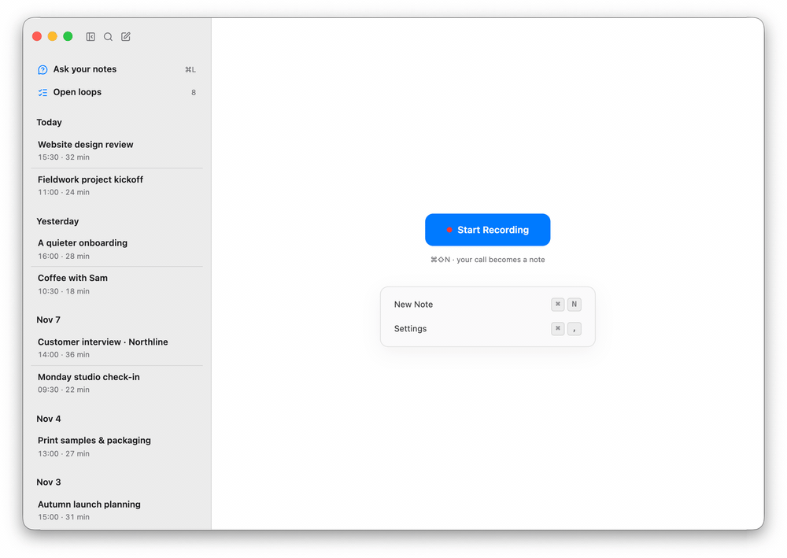

<p align="center">
  
</p>

<h1 align="center">simstim</h1>

<p align="center">
  A local call recorder for macOS. It transcribes on your Mac and writes<br>
  each call to a Markdown file you own.
</p>

<p align="center">
  <a href="https://simstim.tech/download"><strong>Download</strong></a> ·
  <a href="https://simstim.tech">Website</a> ·
  <a href="#install">Install</a> ·
  <a href="#how-it-works">How it works</a> ·
  <a href="docs/privacy.md">Privacy</a>
</p>

<p align="center"><sub>macOS 14.2+ · Apple Silicon · Free · MIT license · Signed and notarized</sub></p>



Simstim records your microphone and system audio as two channels,
transcribes them with local speech models and saves the call as a Markdown
file, with the audio beside it if you keep it. There is no account, no
server and no telemetry. Summaries are optional and go through the AI you
already use, as text only.

## Install

```sh
brew install --cask pgrekovich/tap/simstim
```

Or [download the DMG](https://simstim.tech/download) and drag Simstim into
Applications. Releases are signed with a Developer ID and notarized by
Apple. The app checks GitHub for a newer release once a day and offers it
in a banner; updating is always your click.

On first launch:

1. Choose your notes folder and grant microphone and system-audio access.
2. Wait for the speech models, about **1.55 GB** for the default pair. You
   can record once the live model is ready.
3. Connect an AI assistant if you want summaries and open loops, then start
   a recording.

Recording starts only when you click. Let the other people know before you
record.

## Features

- **Both sides of the call.** Your microphone and system audio are separate
  channels, labeled Me and Them. Whatever plays through your Mac is
  captured; no bot joins the meeting.
- **A live transcript, then an accurate one.** Text appears during the call.
  After Stop, a second local pass over the saved audio improves accuracy.
- **Call detection.** When Zoom, Teams, FaceTime, Slack or a browser tab
  starts using the microphone, a small banner offers to record.
- **Notes next to the transcript.** Your notes, the transcript and AI
  summaries are separate sections. Re-transcription replaces the transcript
  and leaves your notes and metadata alone.
- **Search and playback.** Search across past calls. If you keep the audio,
  click a timestamp to play that moment.
- **Continue a note.** Record into an existing note; earlier audio and
  timestamps are preserved.
- **Open loops.** What you promised, what others promised you and questions
  nobody answered, gathered from every call into one Markdown checklist.
- **Optional AI.** Summaries and questions about your calls through Claude,
  ChatGPT or your own API key.

## The files

Each call is a Markdown file, with an optional audio file beside it.

```text
Your notes/
├── Open loops.md
├── 2026-09-09 15-30-00 call.md
├── 2026-09-09 15-30-00 call.m4a
└── 2026-09-09 11-00-00 call.md
```

```markdown
---
date: 2026-09-09T10:00:00+02:00
title: Beta planning
asr: whisper-large-v3-turbo-q8
duration: 12m
people: Alex, Sam
---

## Notes

Keep the first release focused on recording and readable files.

## Summary

### Decisions

- Start with five testers using different Apple Silicon Macs.

### Open loops

**Mine**

- Send the checklist once the candidate passes review · 00:00:16

## Transcript

[00:00:04] Me: Let's start with five testers on different Macs.
[00:00:09] Them: I'll prepare a short sample call for them.
[00:00:16] Me: Great. I'll send the installation checklist once the candidate passes review.
```

The files are the database. Simstim reads and writes them directly, with no
index or export step, so you can open the same folder in Obsidian, keep it
in git or sync it with your usual backup service.
[Full example note](docs/examples/2026-09-09%2010-00-00%20call.md).

## Open loops

Every summary ends with the call's open loops, each with the moment it was
said. `Open loops.md` sits beside your calls and gathers them in four
sections: Mine, Waiting for, Open questions and Done.

```markdown
## Mine

- [ ] Send the checklist · Sep 9 · [Beta planning](2026-09-09%2010-00-00%20call.md#t=00:00:16)

## Waiting for

- [ ] Sam: a sample call · Sep 9 · [Beta planning](2026-09-09%2010-00-00%20call.md#t=00:00:09)
```

After each summary, Simstim adds the call's new loops and checks off the
ones the call reports as done. Check items off in the app or in any editor;
Done keeps four weeks of history and then clears.

Simstim only adds lines and checks lines in that file. It never rewords or
deletes yours. There are no priorities, reminders or badges: it is one
Markdown file with checkboxes that Obsidian, git and every other editor
already understand. [Example file](docs/examples/Open%20loops.md).

## How it works

| Stage | What runs |
| --- | --- |
| Capture | Microphone through cpal, system audio through Core Audio process taps, kept as separate channels |
| Call detection | Core Audio microphone-usage metadata of known call apps; it only shows the banner |
| Speech detection | Silero VAD |
| Live transcript | Parakeet TDT 0.6B v3 through sherpa-onnx |
| Accurate pass | Whisper large-v3-turbo through whisper.cpp with Metal, over the saved audio after Stop |
| Storage | Markdown saved by atomic replacement; audio flushed during capture, then encoded to AAC or FLAC |
| App | Rust workers in a Tauri shell with a React interface |

Both speech models detect the language themselves. Finalized transcript
segments are appended to disk as they arrive and audio is flushed
periodically during capture. Model files are pinned to a fixed upstream
revision, size and SHA-256.

[Architecture](docs/architecture.md) has the code map and the reasoning
behind the file ownership, audio alignment and permission handling.

## Optional AI

Connect **Claude or ChatGPT** to get summaries, keep your open loops
current and ask questions about your calls. Simstim sets up the official
Claude Code or Codex helper and opens its browser sign-in, without a
terminal. Your provider's plan limits and billing apply; Simstim adds no fee
and sells no credits. You can also use your own OpenAI, Anthropic or
OpenRouter API key, stored in macOS Keychain.

AI requests send text to your provider, never audio.

Without AI, recording, transcription, notes, playback and text search still
work locally. Open loops come from summaries, so they pause when automatic
summaries are off. You can also run your own tools, including local models,
on the saved files. [AI setup and example workflows](docs/your-ai.md).

## Privacy and network

- Audio is recorded and transcribed on your Mac and is never uploaded.
- There are no Simstim accounts, analytics or telemetry.
- API keys live only in macOS Keychain, never in settings or call files.
- Notes and audio are ordinary unencrypted files in the folder you choose.
  If that folder is synced, they sync through that service.

Network activity is limited to speech-model downloads, the daily release
check against GitHub, AI helper setup and version checks, and the AI
requests you make. [Privacy details](docs/privacy.md).

## Limitations

- Apple Silicon Macs only, on macOS 14.2 or later.
- **Me / Them** distinguish your microphone from system audio, not
  individual remote speakers. Headphones help keep the channels separate.
- Recognition can miss names and numbers; timestamps can drift. Check
  important details against the recording.
- Wait for transcription and summaries to finish before continuing a note.
  Edit files in other apps only after Simstim has finished processing them;
  improving a transcript replaces its transcript section.

## Scope

Simstim stays focused on recording calls, transcribing them and keeping
usable files. Being able to build a feature with AI is not a reason to add
it. For PDFs, presentations and follow-up emails, give the Markdown to your
usual assistant, which already has tools for that.

## Configuration

Most settings and `~/.config/simstim/config.toml` share one source of
truth, so they can also be edited by hand. Summary instructions, styles and
quick questions are saved beside it in `prompts.toml`.
[Configuration reference](docs/configuration.md).

## Build from source

Requires an Apple Silicon Mac on macOS 14.2+, Xcode Command Line Tools,
stable Rust, Node and pnpm.

```sh
cd apps/desktop
pnpm install --frozen-lockfile
pnpm tauri dev
```

An unsigned development build records silent system audio until your
terminal is allowed under System Audio Recording Only in System Settings.
The [development guide](docs/development.md) covers this, the four checks
and the fictional UI preview.

## Contributing

[Report a bug](CONTRIBUTING.md#reporting-a-bug) ·
[Contributing](CONTRIBUTING.md) ·
[Architecture](docs/architecture.md) ·
[Security](SECURITY.md)

---

Built with Rust, Tauri, React, Parakeet and Whisper.
[Third-party acknowledgements](THIRD_PARTY_NOTICES.md) · [MIT license](LICENSE)

<sub>Named after simstim in William Gibson's <em>Neuromancer</em>: replaying someone else's recorded sensory experience.</sub>
